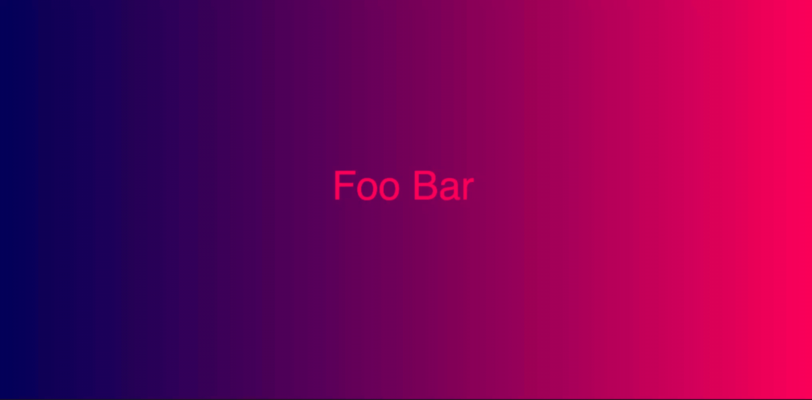

# Week 05

## Code Challenge 5 - Answer

### Create a gradient with alternating text

- My sketch looks  like this:  



- My ```sketch.js``` looks like this

```javascript
let messages = ["Hello World", "Foo Bar"]; // change
let j = 0;
let myColors = [];
let xPos = 0;


function setup() {
  createCanvas(1024, 500);
  background(color(200));
  frameRate(1); 
  for (let i = 0; i < 256; i++) { // why 256?
    myColors.push(i); 
  }
 }
 
 function draw() {
   noStroke();
   for(let i = 0; i < myColors.length; i++) {
      fill(myColors[i], 0, 100);
      rect(xPos, 0, width/256, height);
      xPos = xPos+(width/256);
   }
   // set back to 0
   xPos = 0;

   // add +1 to j
   j++;

   // is j greater or equal to the number of items  messages array    
   if(j >= messages.length) {
      j = 0;
   }
   // add some text on the screen
   textSize(50);
   textAlign(CENTER);
   text(messages[j], width/2, height/2);
 }

```